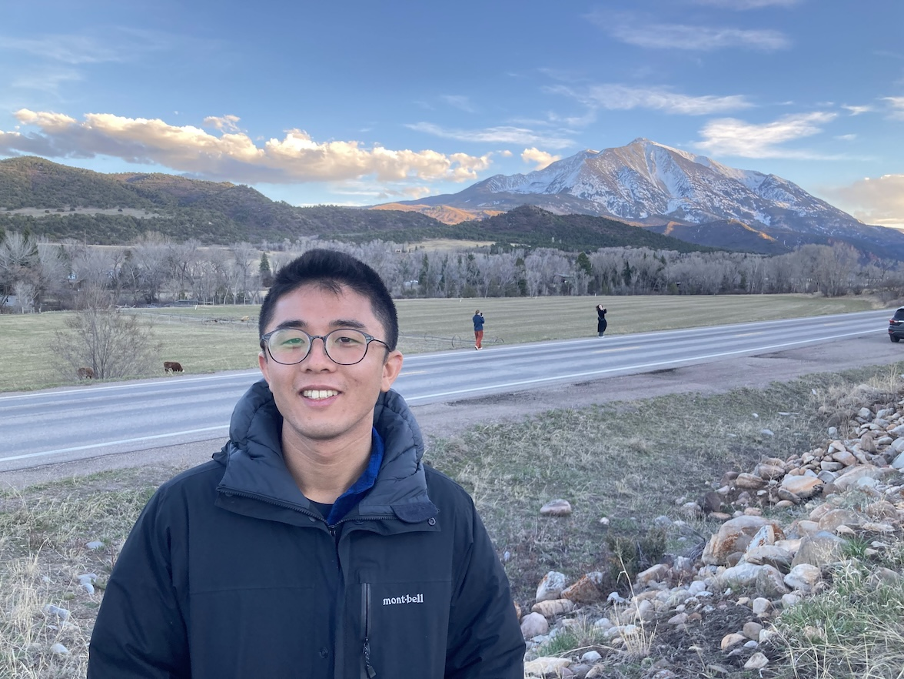

Hi! I'm Hiroaki ("Hiro") Endo, a third-year PhD student in Economics at Northwestern University. I work on macroeconomics, particularly short- to medium-run fluctuations.

Before coming to Northwestern, I completed my BA and MPhil in Economics at St John's College, University of Cambridge. I was fortunate to be funded throughout my four years there by [Nagase Brothers Inc.](https://www.bloomberg.com/profile/company/9733:JP)

In my free time, I enjoy watching — and occasionally [playing](https://www.varsity.co.uk/sport/23709) — rugby union, usually at scrum-half. I have also played rugby league a few times.

{: .float-photo }
